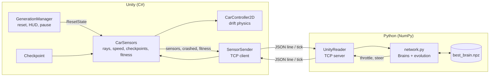

# Architecture

AI race car: 2D drift cars learn to drive a track through neuroevolution. Unity runs the simulation, and a separate Python process holds the neural networks and evolves them. The two communicate over a local TCP socket.

## Overview



Unity is the environment. Python is the agent. Unity never decides how to drive, and Python never touches physics.

## Components

### Unity side

| Script | Responsibility |
|---|---|
| `CarSensors` | Casts 7 rays, reads speed, detects crashes and checkpoints, computes fitness, freezes dead cars, resets state. One per car, auto-assigns IDs (`car1`, `car2`, ...). |
| `CarController2D` | Drift car physics. Exposes `SetAIInput(throttle, steer, handbrake)` so keyboard or AI can drive. |
| `SensorSender` | TCP client. Each physics tick it sends all cars' data to Python and applies the latest controls it received. Reads replies on a background thread. |
| `Checkpoint` | Ordered trigger colliders around the track (`index` 0..N-1). |
| `GenerationManager` | Ends a generation, resets all cars, increments `Gen`. Draws the HUD, pause button (P) and overlay toggle (H). |
| `CarSpawner` | Instantiates the car prefab N times at start. |

### Python side

| File | Responsibility |
|---|---|
| `reader.py` | `UnityReader`: TCP server on `127.0.0.1:5000`. Splits the stream into newline-delimited JSON messages, calls a handler, sends replies. Knows nothing about neural networks. |
| `network.py` | The `Brain` class, the evolution loop, and save/load. This is the file you run. |
| `best_brain.npz` | Saved weights and score of the best brain found so far. |

## Data flow per physics tick

1. `CarSensors.FixedUpdate` updates ray distances and speeds for every car.
2. `SensorSender.FixedUpdate` applies any controls received from Python, then sends one JSON line with every car's state.
3. `UnityReader` parses the line and calls `handle(msg)` in `network.py`.
4. `handle` runs each car's `Brain` on its sensors and replies with throttle and steer.
5. Unity's read thread keeps the newest reply. On the next tick it is applied through `CarSensors.SetAI` to `CarController2D`.

Controls therefore lag sensors by about one tick, which is fine at this tick rate.

## Protocol

Newline-delimited JSON over TCP. Unity connects to Python once at `Start`, so start Python first.

**Unity to Python** (one line per physics tick):

```json
{"gen": 3, "cars": {
  "car1": {"sensors": [0.4, 0.6, 1, 1, 1, 0.7, 0.3, 0.42, -0.01], "crashed": false, "fitness": 2.37},
  "car2": {"sensors": [...], "crashed": true, "fitness": 0.81}
}}
```

**Python to Unity:**

```json
{"controls": [
  {"id": "car1", "steer": -0.12, "throttle": 0.8},
  {"id": "car2", "steer": 0.0, "throttle": 0.0}
]}
```

The controls use a list, not a dictionary, because Unity's `JsonUtility` cannot parse objects with dynamic keys.

### Sensor vector (9 values per car)

| Index | Meaning | Range |
|---|---|---|
| 0-6 | Ray distances at -60°, -40°, -20°, 0°, +20°, +40°, +60° | 0 (touching wall) to 1 (nothing within range) |
| 7 | Forward speed / max speed | -1 to 1 |
| 8 | Sideways speed / max speed | -1 to 1 |

All inputs are relative to the car, so the brain does not know where on the map it is, or how the track is oriented.

### Control convention

The network outputs `steer` in -1..1 with positive meaning right. `CarController2D` treats positive as left, so `CarSensors.SetAI` negates it before passing it on.

## The brain

A small fully connected network written in NumPy, with no ML framework.

```
9 inputs -> 9 (ReLU) -> 4 (ReLU) -> 2 (tanh) = [throttle, steer]
```

- Weights use He-style initialization. Biases start as small random values, because zero biases produced "dead" networks that output exactly 0 forever.
- Parameters are a flat list of arrays (`w1, b1, w2, b2, ...`), which makes copy, mutate and save trivial.
- Total size is about 140 parameters.

## Fitness

Fitness is progress along the track, measured in checkpoints:

- Each car tracks the **next expected checkpoint**. Touching any other one does nothing, so reversing and shortcuts score nothing.
- `fitness = checkpoints passed + fraction (0..1) of the distance to the next one`.
- After the last checkpoint, the index wraps to 0 and lap counting continues.
- A car with no new checkpoint for `stallTime` (6 s) is marked crashed.

When ranking, Python subtracts a time cost so faster cars win:

```
score = best_fitness - TIME_PENALTY * seconds_alive
```

## Generation lifecycle

1. Cars drive using their brains. A crash (collision with the wall layer) or a stall freezes the car in place (`rb.simulated = false`). It keeps reporting `crashed: true`.
2. `GenerationManager` ends the generation when **all cars are crashed** or `maxGenTime` (60 s) elapses. It waits a few frames so Python receives the final fitness values.
3. All cars teleport to their spawn position and rotation, with controller state cleared (`ResetState`, `ResetControl`). `Gen` increments.
4. Python notices that `gen` changed and runs `evolve()` before replying to the first message of the new generation.

## Evolution

Runs in `network.py` every time `gen` changes.

1. **Rank** brains by score (best fitness minus time penalty).
2. **Record:** if the top score beats the saved record, write that brain to `best_brain.npz`.
3. **Select:** the top `ELITE` (4) brains become parents.
4. **Build the next population:**
   - 1 unchanged copy of the best brain, so the best result is never lost.
   - Mutated copies of random parents. Each weight has a `MUT_RATE` chance of getting Gaussian noise. Noise strength is random per child, so some are small tweaks and some are big jumps.
   - A few fully random brains (0 below 5 cars, 2 below 12, otherwise 4) to keep exploring.
5. **Adaptive mutation:** a `stale` counter counts generations without a real improvement (+0.05). Mutation rate and strength are multiplied by `1 + 0.25 * min(stale, 12)` (up to 4x), and reset when a new record is found.

## Persistence

- `best_brain.npz` stores the weights, biases and score of the best brain.
- On startup, the saved brain seeds generation 1: one unchanged copy, mutated copies, and a few random cars.
- The record is compared in the current scoring scale, so `best_saved` restarts very low on every run. The first generation of a new run therefore overwrites the file. Back it up before experiments.
- To reset training, delete the file or set `RESET = True`. If the network shape (`SIZES`) changes, the old file fails to load and training starts fresh.

## Configuration

| Setting | File | Default | Effect |
|---|---|---|---|
| `ELITE` | `network.py` | 4 | Number of parents per generation |
| `MUT_RATE` | `network.py` | 0.10 | Chance each weight is mutated |
| `TIME_PENALTY` | `network.py` | 0.03 | Score lost per second alive; higher favors speed |
| `TICK_RATE` | `network.py` | 50 | Messages per second (`1 / fixedDeltaTime`) |
| `RESET` | `network.py` | False | Ignore the saved brain |
| `SIZES` | `network.py` | `[9, 9, 4, 2]` | Network shape |
| `maxGenTime` | `GenerationManager` | 60 | Seconds before a generation is cut off |
| `stallTime` | `CarSensors` | 6 | Seconds without progress before a car is killed |
| `rayLength` | `CarSensors` | 5 | Ray range |
| `count` | `CarSpawner` | 20+ | Population size |

## Design decisions

- **Python as the server, Unity as the client.** Python can stay running while you stop and restart Unity.
- **Neuroevolution, not gradient descent.** There is no labeled data, only a score, so selection and mutation fit naturally. The network is small enough that evolution works.
- **Checkpoint fitness, not raw distance.** Distance rewards circling and wiggling. Ordered checkpoints reward only real progress.
- **Frozen, not destroyed.** Dead cars stay in the scene and keep reporting, so IDs stay stable across generations.
- **Latest message wins.** `UnityReader` handles only the newest message in each batch, and the Unity read thread keeps only the newest reply. Both sides prefer fresh data over a backlog.
- **Relative sensing only.** The brain sees ray distances and speeds, never absolute position, so rotating the track changes nothing for it.

## Limitations

- Trained on a single layout, the brain partly memorizes it. A mirrored track was completed by only one car.
- Only 7 rays, each within ±60°, so sharp corners are visible late.
- The record resets on each restart, and the first generation overwrites the saved file.
- Controls lag sensors by about one tick.
- The handbrake is not an AI output yet.

## Extension ideas

- Train on several tracks, alternating them between generations, and rank by average or worst-case score.
- Add the handbrake as a third network output (`SIZES` ends in 3, which invalidates saved brains).
- Add a demo mode that loads the best brain with no mutation and no saving.
- Add a lap timer and a training-curve plot (log best and average per generation).
- Race a human-driven car against the AI.
